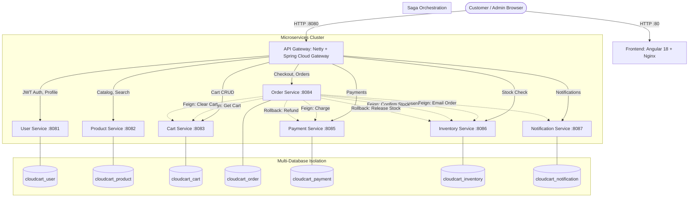

# CloudCart – Cloud-Native Microservices E-Commerce Platform


> **CloudCart** is an enterprise-grade, cloud-native microservices e-commerce platform engineered to demonstrate modern distributed systems architecture, clean domain boundaries, transactional consistency via distributed Saga orchestration, database-per-service isolation, resilience, and containerized cloud deployment.

---

## Table of Contents
1. [System Architecture](#system-architecture)
2. [Microservices Breakdown](#microservices-breakdown)
3. [Key Engineering Highlights](#key-engineering-highlights)
   - [Distributed Saga Checkout & Compensating Rollback](#distributed-saga-checkout--compensating-rollback)
   - [Pessimistic Concurrency in Inventory](#pessimistic-concurrency-in-inventory)
   - [Database-Per-Service Pattern](#database-per-service-pattern)
   - [Security & PCI-DSS Compliance](#security--pci-dss-compliance)
4. [Technology Stack](#technology-stack)
5. [100% Free 24/7 Cloud Deployment (Vercel + Render + Neon)](#100-free-247-cloud-deployment-vercel--render--neon)
6. [Quickstart: Local Docker Compose](#quickstart-local-docker-compose)
7. [Local Development Setup](#local-development-setup)
8. [Kubernetes Deployment (Minikube / Cloud)](#kubernetes-deployment-minikube--cloud)
9. [CI/CD Pipelines (Jenkins & GitHub Actions)](#cicd-pipelines-jenkins--github-actions)
10. [AWS Cloud Deployment (ECS Fargate & RDS)](#aws-cloud-deployment-ecs-fargate--rds)
11. [API Documentation & Postman Collection](#api-documentation--postman-collection)
12. [Portfolio & Technical Interview Talking Points](#portfolio--technical-interview-talking-points)

---

## System Architecture



---

## Microservices Breakdown

| Service | Port | Description & Responsibilities | Tech Stack |
|---|---|---|---|
| **`api-gateway`** | `8080` | Unified edge gateway, JWT extraction, role propagation (`X-User-Role`), distributed correlation ID (`X-Correlation-ID`), CORS filter, Resilience4j fallback. | Spring Cloud Gateway, Netty |
| **`user-service`** | `8081` | Authentication, BCrypt password hashing, JWT issue/validation, customer profiles, address book, RBAC (`CUSTOMER`, `ADMIN`). | Spring Boot 3, Spring Security 6, PostgreSQL |
| **`product-service`** | `8082` | Product catalog, multi-category hierarchies, keyword search, price filtering, pagination, admin product management, Feign inventory client with circuit breaker. | Spring Boot 3, Spring Data JPA, Resilience4j |
| **`inventory-service`**| `8086` | Real-time stock management, pessimistic locking stock reservation, confirmation, and release. Zero overselling guarantee. | Spring Boot 3, Hibernate Pessimistic Locking |
| **`cart-service`** | `8083` | Persistent shopping carts per user, subtotal calculations, price sync with product service, stock validation. | Spring Boot 3, Spring Data JPA, OpenFeign |
| **`order-service`** | `8084` | **Distributed Saga Orchestrator**, checkout flow coordination, automated rollback compensation, order tracking, order cancellation with inventory and refund reconciliation. | Spring Boot 3, OpenFeign, Resilience4j |
| **`payment-service`**| `8085` | Payment simulation gateway, token-based card processing (`CARD_SUCCESS`, `CARD_DECLINED`, `CARD_INSUFFICIENT_FUNDS`), idempotent transaction ledger, refund processing. | Spring Boot 3, Spring Data JPA |
| **`notification-service`**| `8087` | Simulated email & SMS notification dispatcher, delivery history audit logging for order and payment events. | Spring Boot 3, Spring Data JPA |
| **`frontend`** | `4200` / `80` | High-performance modern Single-Page Application (SPA) with responsive customer storefront, cart, checkout, order history, and executive admin dashboard. | Angular 18, TypeScript, RxJS, Nginx |

---

## Key Engineering Highlights

### Distributed Saga Checkout & Compensating Rollback
Instead of fragile, locking distributed transactions (2PC), checkout uses the **Orchestrated Saga Pattern**:
1. **Order Initiation:** Order persisted in `PENDING` status.
2. **Stock Reservation:** Calls `inventory-service` to atomically reserve stock (`PESSIMISTIC_WRITE`).
3. **Payment Processing:** Calls `payment-service` with payment token and idempotency key.
4. **Success Path:** Stock is permanently confirmed, the user's cart is cleared, order moves to `CONFIRMED`, and an email notification is dispatched.
5. **Compensating Rollback:** If payment fails (e.g. `CARD_DECLINED`), the orchestrator triggers an immediate compensating call to `inventory-service` (`/api/v1/inventory/release`), reverting the reserved stock back to available before marking the order `FAILED`.

### Pessimistic Concurrency in Inventory
To eliminate overselling during concurrent checkouts, stock reservation utilizes:
```java
@Lock(LockModeType.PESSIMISTIC_WRITE)
@Query("SELECT i FROM Inventory i WHERE i.sku = :sku")
Optional<Inventory> findBySkuWithLock(@Param("sku") String sku);
```
This issues a native SQL `SELECT ... FOR UPDATE`, guaranteeing that competing checkout threads serialize cleanly at the database level.

### Database-Per-Service Pattern
- **Strict Isolation:** 7 distinct logical PostgreSQL databases (`cloudcart_user`, `cloudcart_product`, `cloudcart_cart`, `cloudcart_order`, `cloudcart_payment`, `cloudcart_inventory`, `cloudcart_notification`).
- **Zero Cross-Database Joins:** Services communicate exclusively through contracts defined in `common-dto`.
- **Flyway Versioned Migrations:** Each microservice manages its own schema evolution independently via Flyway scripts (`V1__...`, `V2__...`).

### Security & PCI-DSS Compliance
- **Spring Security 6 Stateless Filter Chain:** Cryptographic verification using HMAC-SHA256 JWT tokens.
- **Role-Based Access Control (RBAC):** Granular authorization for `CUSTOMER` and `ADMIN` roles.
- **Zero Raw Card Data:** Strictly adheres to PCI-DSS by processing only one-time token references (`CARD_SUCCESS`, etc.). Raw credit card numbers and CVVs are never accepted or stored.
- **Distributed MDC Tracing:** Automated propagation of `X-Correlation-ID` across HTTP hops and Logback logs.

---

## Technology Stack

- **Backend:** Java 21, Spring Boot 3.3.5, Spring Cloud 2023.0.3, Spring Cloud Gateway, OpenFeign, Resilience4j, Spring Security 6, Spring Data JPA, Flyway, Maven.
- **Frontend:** Angular 18 (Standalone Components), TypeScript, RxJS, Modern CSS3 Flexbox/Grid, Nginx.
- **Database:** PostgreSQL 16.
- **DevOps & Cloud:** Docker, Docker Compose, Kubernetes (Deployments, Services, ConfigMaps, Secrets, HPAs, Ingress), Jenkins, GitHub Actions, AWS ECS Fargate, AWS RDS PostgreSQL, AWS ALB, Amazon ECR, Terraform IaC, Vercel, Render.
- **Testing:** JUnit 5, Mockito, AssertJ, Spring Boot Test, Postman.

---

## 100% Free 24/7 Cloud Deployment (Vercel + Render + Neon)

You can deploy the complete live, working platform **100% free with no credit card required**, running 24/7 even when your laptop is turned off:

- **Frontend:** Deployed to **Vercel** (Global edge CDN, automated HTTPS)
- **Backend:** Deployed to **Render.com** via `services/cloudcart-unified` (Modular Spring Boot 3 cloud runtime with dynamic port binding and `-Xmx320m` memory optimization fitting within Render's free 512MB RAM tier)
- **Database:** Hosted on **Neon.tech** (Serverless PostgreSQL with SSL)

👉 **[Read the Complete Free Deployment Step-by-Step Guide](file:///Users/omugale/.gemini/antigravity/scratch/cloudcart/documentation/DEPLOYMENT_FREE_TIER.md)**

---

## Quickstart: Local Docker Compose

Run the entire distributed system (all 8 microservices, PostgreSQL, and Angular frontend) with one command:

```bash
# Clone and navigate to project root
cd cloudcart

# Start all containers in background
docker compose up --build -d

# View real-time cluster logs
docker compose logs -f
```

### Accessing the Platform

- **Storefront & Admin UI:** [http://localhost](http://localhost) (or [http://localhost:4200](http://localhost:4200))
- **API Gateway Entrypoint:** [http://localhost:8080](http://localhost:8080)
- **Actuator Health Endpoint:** [http://localhost:8080/actuator/health](http://localhost:8080/actuator/health)

### Default Seed Accounts

| Role | Email | Password | Access Capabilities |
|---|---|---|---|
| **Admin (Primary)** | `admin@cloudcart.com` | `Admin123!` | Full Admin Dashboard, Catalog Management, Order Status Updates |
| **Customer (Primary)** | `customer@cloudcart.com` | `Customer123!` | Browsing, Cart, Simulated Checkout, Order Tracking |
| **Admin (Alternative)** | `admin@cloudcart.internal` | `admin123` | Secondary Admin Account |
| **Customer (Alternative)** | `customer@example.com` | `password123` | Secondary Customer Account |

---

## Local Development Setup

### 1. Prerequisites
- **JDK 21** installed (`java -version`)
- **Node.js 20+** and **npm 10+** (`node -v`)
- **Docker** & **Docker Compose** (for PostgreSQL)

### 2. Build Backend Services
```bash
# Run Maven reactor build and test suites
./mvnw clean install
```

### 3. Build & Run Frontend
```bash
cd frontend
npm install
npm run build
npm start
```

---

## Kubernetes Deployment (Minikube / Cloud)

CloudCart includes production-ready Kubernetes manifests featuring Deployments, Services, ConfigMaps, Secrets, Horizontal Pod Autoscalers (HPAs), and Ingress:

```bash
# Start Minikube cluster with Ingress & Metrics
minikube start --cpus=4 --memory=8192
minikube addons enable ingress metrics-server

# Deploy entire platform with Kustomize
kubectl apply -k infrastructure/kubernetes/

# Check pod rollouts
kubectl get pods -n cloudcart -w
```
See the full guide in [infrastructure/kubernetes/README.md](file:///Users/omugale/.gemini/antigravity/scratch/cloudcart/infrastructure/kubernetes/README.md).

---

## CI/CD Pipelines (Jenkins & GitHub Actions)

- **Jenkinsfile (`infrastructure/jenkins/Jenkinsfile`):** 9-stage declarative enterprise pipeline:
  1. Source Checkout
  2. Toolchain Verification
  3. Backend Unit & Integration Tests (JUnit surefire publishing)
  4. Packaging Microservice JARs
  5. Angular Production Build & Asset Validation
  6. Parallel Docker Image Builds
  7. ECR Authentication & Image Push
  8. AWS ECS Rolling Deployment
  9. Automated Health Check Verification
- **GitHub Actions (`.github/workflows/ci-cd.yml`):** Complete workflow for pull request verification and automated branch builds.

---

## AWS Cloud Deployment (ECS Fargate & RDS)

Production Infrastructure-as-Code (IaC) is provided in `infrastructure/aws/terraform`:
- **AWS ECS with Fargate:** Serverless container execution for zero-maintenance container operations.
- **AWS Application Load Balancer:** Path-based routing for `/api/v1/*` to Gateway and `/` to Frontend.
- **AWS RDS PostgreSQL (`db.t4g.micro`):** Cost-conscious free-tier eligible multi-tenant database.
- **CloudWatch Logs & IAM:** Structured logging and least-privilege task execution roles.

See the complete AWS Deployment guide and cost optimization walkthrough in [infrastructure/aws/DEPLOYMENT_AWS.md](file:///Users/omugale/.gemini/antigravity/scratch/cloudcart/infrastructure/aws/DEPLOYMENT_AWS.md).

---

## API Documentation & Postman Collection

Import the included collection and environment into Postman:
- **Collection:** [`postman/CloudCart_API_Collection.postman_collection.json`](file:///Users/omugale/.gemini/antigravity/scratch/cloudcart/postman/CloudCart_API_Collection.postman_collection.json)
- **Environment:** [`postman/CloudCart_Environment.postman_environment.json`](file:///Users/omugale/.gemini/antigravity/scratch/cloudcart/postman/CloudCart_Environment.postman_environment.json)

The collection includes automated test scripts that capture JWT tokens and order numbers across chained requests.

---

## Portfolio & Technical Interview Talking Points

When presenting CloudCart on your resume or in technical interviews, highlight:

1. **Distributed Eventual Consistency vs. 2PC:**
   - *Question:* "How did you maintain data consistency across checkout microservices?"
   - *Answer:* "I implemented an Orchestrated Saga pattern in Order Service using Spring Cloud OpenFeign and Resilience4j. When a user submits an order, the orchestrator reserves stock, executes payment, confirms stock, and clears the cart. If payment fails, the orchestrator executes compensating transactions that release the reserved inventory back to available stock."

2. **Preventing Flash-Sale Concurrency Overselling:**
   - *Question:* "How do you handle race conditions when thousands of users attempt to purchase the last item in stock?"
   - *Answer:* "I used JPA pessimistic write locking (`@Lock(LockModeType.PESSIMISTIC_WRITE)`) in Inventory Service. This triggers SQL `SELECT ... FOR UPDATE`, ensuring that simultaneous checkout transactions acquire row locks and serialize stock decrements without overselling."

3. **Decoupled Database Autonomy:**
   - *Question:* "Why did you use separate databases rather than a single database with multiple schemas or tables?"
   - *Answer:* "To adhere to the Microservices Database-Per-Service pattern. By isolating the databases, no service can bypass APIs to perform tight foreign key joins. It enables autonomous schema migrations via Flyway, independent scaling, and allows swapping database engines per service if required."

4. **Security & Resiliency at the API Edge:**
   - *Question:* "How is security handled across microservices?"
   - *Answer:* "The API Gateway acts as the secure perimeter, verifying JWT signatures, filtering expired tokens, and injecting sanitized claims downstream via `X-User-Id` and `X-User-Role` headers. Internal services remain stateless and protected from direct external exposure."
