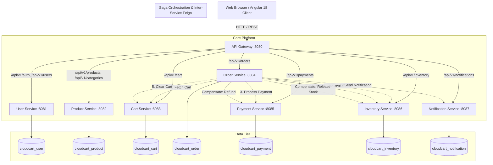

# CloudCart – Architecture & Microservices Deep Dive

## 1. System Philosophy & Enterprise Design Patterns

CloudCart is engineered to emulate real-world Tier-1 e-commerce architectures (e.g. Amazon, Shopify). The application rejects naive monolithic shortcuts in favor of:

1. **Database-Per-Service Pattern:**
   - Seven logically isolated PostgreSQL databases ensure strict domain encapsulation.
   - Zero foreign keys across service boundaries; domain entities reference foreign resources exclusively through natural immutable keys (such as `sku`, `userId`, or `orderNumber`).

2. **Distributed Saga Orchestration:**
   - Checkout is orchestrated via a coordinated Saga across `order-service`, `inventory-service`, `payment-service`, `cart-service`, and `notification-service`.
   - Forward actions (`reserveStock`, `processPayment`, `clearCart`) are paired with backward compensating transactions (`releaseStock`, `refundPayment`) to guarantee eventual consistency across distributed boundaries without distributed 2PC locks.

3. **Pessimistic Concurrency for Stock Allocations:**
   - High-throughput flash sales risk stock overselling under optimistic locking.
   - `inventory-service` executes stock reservations with `@Lock(LockModeType.PESSIMISTIC_WRITE)` (`SELECT ... FOR UPDATE`), serializing concurrent item deductions safely within isolated database transactions.

4. **Idempotency & Resiliency:**
   - Payment operations require unique idempotency keys (`X-Idempotency-Key` or payload keys), preventing duplicate charges upon network timeouts.
   - Inter-service Feign calls are protected by Resilience4j circuit breakers and fallbacks, preventing cascading failures across the cluster.

5. **Distributed Correlation Tracing:**
   - Every ingress request entering `api-gateway` receives a unique `X-Correlation-ID` header if not provided.
   - This header is propagated through every downstream HTTP request and Spring Boot Actuator/Logback MDC context for distributed tracing.

---

## 2. Distributed Microservices Boundary

---

## 3. Network Ports & Service Catalog

| Service | Port | Primary Responsibilities | Database |
|---|---|---|---|
| **api-gateway** | `8080` | Reverse proxy, JWT validation, header enrichment, rate limiting, routing | None (Stateless) |
| **user-service** | `8081` | Authentication, BCrypt password hashing, JWT issue, profiles, RBAC | `cloudcart_user` |
| **product-service** | `8082` | Product catalog, categories, multi-filter search, pagination | `cloudcart_product` |
| **cart-service** | `8083` | Persistent shopping carts, subtotal computations, item management | `cloudcart_cart` |
| **order-service** | `8084` | Distributed Checkout Saga orchestrator, order tracking, cancellation | `cloudcart_order` |
| **payment-service** | `8085` | Payment simulation, token authorization, idempotent ledger, refunds | `cloudcart_payment` |
| **inventory-service** | `8086` | Pessimistic stock reservation, confirmation, release, zero-oversell | `cloudcart_inventory` |
| **notification-service**| `8087` | Order & payment event dispatching, simulated email logs | `cloudcart_notification` |
| **frontend** | `4200` (Dev) / `80` (Docker) | Angular 18 Single-Page Application (Storefront & Admin UI) | LocalStorage (JWT) |
