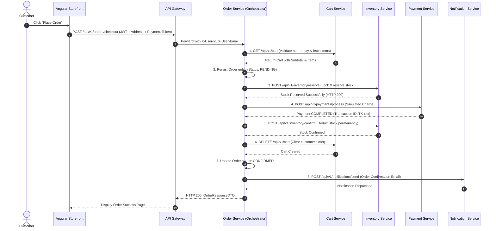
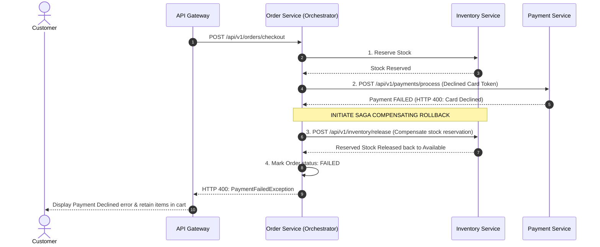

# CloudCart – Distributed Saga Checkout Flow

The checkout workflow coordinates multiple microservices to guarantee transactional consistency across network and database boundaries without blocking two-phase commits (2PC).

## 1. Sequence Diagram: Happy Path Checkout



---

## 2. Sequence Diagram: Payment Failure & Compensating Rollback

When a payment fails (e.g. `CARD_DECLINED` or `CARD_INSUFFICIENT_FUNDS`), the orchestrator triggers immediate compensation to release reserved inventory.



---

## 3. Order Status State Machine

```
      [ Cart Active ]
             │ (Checkout Started)
             ▼
        [ PENDING ] ──────(Stock Unavailable)─────► [ CANCELLED ]
             │
             │ (Stock Reserved)
             ▼
     [ PAYMENT_PENDING ] ─(Payment Declined)─────► [ FAILED ]
             │                                    (Compensate: Release Stock)
             │ (Payment Success)
             ▼
       [ CONFIRMED ] ─────(User Cancels)─────────► [ CANCELLED ]
             │                                    (Compensate: Release Stock + Refund)
             │
             ▼
       [ PROCESSING ]
             │
             ▼
        [ SHIPPED ]
             │
             ▼
       [ DELIVERED ]
```
